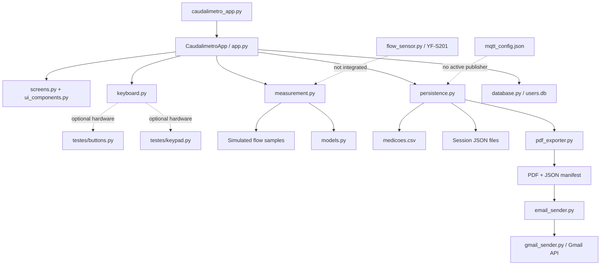

# Flowmeter App — Industrial Mold Cooling Circuit Measurement

A Python desktop application for recording and managing water-flow measurements in mold cooling circuits. The application is designed for a workstation or a Raspberry Pi connected to a display and, optionally, industrial push buttons and a matrix keypad.

It provides operator authentication, guided circuit-by-circuit measurements, local data storage, PDF report generation, and report delivery using the Gmail API.

> [!IMPORTANT]
> **Prototype / development status:** The measurement screens currently use **simulated flow values**. A YF-S201 pulse-reading driver exists, but it is **not connected to the application's measurement workflow**. Do not treat the displayed flow readings as verified measurements from physical equipment.

## Contents

- [Project status](#project-status)
- [Features](#features)
- [Technology stack](#technology-stack)
- [Architecture](#architecture)
- [Repository structure](#repository-structure)
- [File-by-file reference](#file-by-file-reference)
- [Getting started](#getting-started)
- [First-time operator setup](#first-time-operator-setup)
- [Using the application](#using-the-application)
- [Keyboard and physical controls](#keyboard-and-physical-controls)
- [Data storage and record lifecycle](#data-storage-and-record-lifecycle)
- [PDF reports and Gmail integration](#pdf-reports-and-gmail-integration)
- [Flow sensor and Raspberry Pi hardware](#flow-sensor-and-raspberry-pi-hardware)
- [Testing](#testing)
- [Known limitations](#known-limitations)
- [Development roadmap](#development-roadmap)
- [Security and repository hygiene](#security-and-repository-hygiene)

## Project status

| Capability | Current status | Notes |
| --- | --- | --- |
| Tkinter application and navigation | Implemented | Designed around an 800 × 480 base layout; window behavior depends on the OS. |
| Operator login and administration | Implemented | Local SQLite database; PINs are stored as salted PBKDF2 hashes. |
| Mold, side, diameter, pressure, and circuit setup | Implemented | Guided measurement workflow. |
| Flow measurement and statistics | **Simulation only in the UI** | Current/minimum/average/maximum flow values are computed from simulated samples. |
| YF-S201 pulse acquisition | Separate driver available | `flow_sensor.py` is not integrated with `measurement.py`. |
| Physical buttons and 4 × 3 keypad | Drivers implemented | Require compatible Raspberry Pi GPIO hardware; not verified in this review. |
| Local CSV and JSON storage | Implemented | CSV history, completed sessions, and local archives. |
| Mold-based PDF reports | Implemented | ReportLab; PDF and JSON manifest generated together. |
| Gmail report delivery | Implemented | OAuth 2.0 / Gmail API, with configuration and authorized credentials. |
| MQTT transmission | **Not implemented** | A configuration file exists, but no active MQTT publisher is present. |
| Remote intranet synchronization | **Not implemented** | Locally archiving a session is not the same as uploading it to a server. |

## Features

**Operator workflow**

- Sign in using an operator account and PIN.
- Identify the mold and select one of the supported mold sides.
- Configure the circuit diameter, inlet pressure, number of circuits, and starting circuit number.
- Record each circuit's current, minimum, average, and maximum flow (L/min).
- Review results, repeat measurements, and manually edit the recorded average when required.
- Finish a measurement session and review saved records.

**Administration and reporting**

- Manage operator accounts (create, remove, and reset operator PINs).
- Inspect pending measurements and exported records.
- Export selected measurements belonging to the same mold into an A4 PDF report.
- Keep a JSON manifest alongside every exported PDF.
- Email an individual PDF/JSON pair or all eligible unemailed pairs through Gmail.
- Optionally trigger Gmail delivery after an export, when explicitly enabled in the email configuration.

## Technology stack

| Area | Technology |
| --- | --- |
| Language | Python 3.10+ (Python 3.11 recommended for development) |
| Graphical interface | Tkinter / Tcl-Tk |
| Local user database | SQLite (`sqlite3`, Python standard library) |
| Application models | Python dataclasses |
| Local records | JSON and semicolon-delimited CSV |
| Report generation | ReportLab |
| Image assets | Pillow / PNG |
| Email authentication and sending | Google OAuth 2.0, Gmail API, `google-api-python-client`, `google-auth`, `google-auth-oauthlib` |
| Raspberry Pi inputs | `gpiozero` and `RPi.GPIO` (hardware-dependent; not listed in the main requirements file) |
| Optional system scripts | Perl (`limpar.pl`, `wifi_check.pl`) |

No separate web server, REST backend, remote database, or MQTT broker is required to launch the existing desktop interface.

## Architecture

The application is a local Python/Tkinter program organized into **mixins by responsibility**. `CaudalimetroApp` is the main Tkinter window and combines the UI, input handling, measurement workflow, and persistence behavior.



### High-level responsibility split

| Module | Responsibility |
| --- | --- |
| `app.py` | Application initialization, global state, scheduling, hardware input initialization, and cleanup. |
| `screens.py` | Screen construction, display state, navigation flows, and screen-specific actions. |
| `ui_components.py` | Shared Tkinter widgets, styling, and layout helpers. |
| `keyboard.py` | PC keyboard, keypad, and physical button action mapping. |
| `measurement.py` | Circuit sequencing, sampling, statistics, result review, and remeasurement. |
| `persistence.py` | Sessions, CSV, archives, PDF export orchestration, and saved-record management. |

## Repository structure

The supplied archive has an outer `Flowmeter-App-PC/` directory. The **Python application's working directory** is the nested `caudalimetro_app/` directory, which already contains an older `README.md`. This document is intended to **replace that existing README**.

```text
Flowmeter-App-PC/
├── .gitignore
├── limpar.pl                       # Maintenance / old-record cleanup script
├── .agents/                        # Empty in the reviewed archive
├── caudalimetro_app/               # Run the app from here
│   ├── README.md                   # This documentation
│   ├── requirements.txt            # Main Python dependencies
│   ├── caudalimetro_app.py         # Application entry point
│   ├── wifi_check.pl               # Optional Linux Wi-Fi check script
│   ├── caudalimetro/
│   │   ├── __init__.py
│   │   ├── app.py
│   │   ├── config.py
│   │   ├── database.py
│   │   ├── models.py
│   │   ├── keyboard.py
│   │   ├── measurement.py
│   │   ├── persistence.py
│   │   ├── screens.py
│   │   ├── ui_components.py
│   │   ├── flow_sensor.py
│   │   ├── testar_caudal.py
│   │   ├── pdf_exporter.py
│   │   ├── email_sender.py
│   │   ├── gmail_sender.py
│   │   ├── aha.png
│   │   ├── ipl.png
│   │   ├── credentials.json         # Local Gmail OAuth client secret; do not commit
│   │   └── token.json               # Local OAuth token; do not commit
│   ├── testes/
│   │   ├── buttons.py
│   │   ├── keypad.py
│   │   ├── testar_caudal2.py
│   │   └── test_email_sender.py
│   └── data/
│       ├── users.db                 # Local operator database
│       ├── operadores.json          # Legacy data; contains plaintext PINs
│       ├── email_config.json        # Email preferences
│       ├── mqtt_config.json         # Not currently used by a publisher
│       ├── medicoes.csv             # Append-only measurement history
│       ├── sessoes/                 # Completed / pending session JSON
│       ├── enviados/                # Locally archived session JSON
│       ├── pdf_exportados/          # PDF reports + JSON manifests
│       └── emails/                  # Working directory created by the app
└── .git/                            # Git metadata in the supplied archive
```

`__pycache__/` directories and `*.pyc` files may also be present. They are generated Python bytecode caches, not separate application modules. The archive also contains historical Git objects and existing measurement data; these should not be considered required source files.

## File-by-file reference

### Application entry point and core modules

| File | Purpose |
| --- | --- |
| `caudalimetro_app.py` | Imports `CaudalimetroApp`, creates the main window, and starts Tkinter's `mainloop()`. |
| `caudalimetro/__init__.py` | Exposes `CaudalimetroApp` through the package. |
| `caudalimetro/app.py` | Defines `CaudalimetroApp`; initializes settings, working directories, users, splash screen, event queue, hardware input drivers, and startup export checks. |
| `caudalimetro/config.py` | Central constants: display dimensions, colors, font sizes, directories, available diameter values, menu options, and simulation parameters. |
| `caudalimetro/models.py` | `MeasurementRecord` and `MeasurementSession` dataclasses, including circuit statistics and session metadata. |
| `caudalimetro/database.py` | Creates/opens `users.db`; supports user creation, authentication, deletion, password changes, and listing; stores salted PBKDF2-HMAC-SHA256 hashes. |
| `caudalimetro/keyboard.py` | Routes keyboard events and hardware button/keypad input to the correct action for the current screen. |
| `caudalimetro/measurement.py` | Controls each measurement run, produces simulated samples, calculates statistics, stores circuit results, and supports edits and remeasurement. |
| `caudalimetro/persistence.py` | Saves completed sessions, appends to CSV, manages pending/archived records, merges selected measurements, and coordinates PDF generation and optional email sending. |
| `caudalimetro/screens.py` | Implements splash, login, administrative screens, mold configuration, measurement, results, review, export, and exported-report management. |
| `caudalimetro/ui_components.py` | Reusable widgets, footers, visual styling, selection highlights, and screen layout utilities. |

### Reporting, communication, and acquisition

| File | Purpose |
| --- | --- |
| `caudalimetro/pdf_exporter.py` | Generates A4 measurement reports grouped by mold side, including circuit results and supporting information. |
| `caudalimetro/email_sender.py` | Loads email preferences, finds valid PDF/JSON pairs, builds MIME messages, selects single/all exports, records successful sending in manifests, and provides asynchronous helpers. |
| `caudalimetro/gmail_sender.py` | Obtains Google OAuth credentials, refreshes/stores tokens, and sends messages using the Gmail API. |
| `caudalimetro/flow_sensor.py` | Independent `YFS201Sensor` implementation: GPIO pulse counting, flow calculation, smoothing, zero-flow detection, and total volume tracking. Not yet used by the measurement UI. |
| `caudalimetro/testar_caudal.py` | Standalone Raspberry Pi pulse-counting and flow-measurement experiments using `RPi.GPIO`. |

### Hardware helpers, tests, and utilities

| File | Purpose |
| --- | --- |
| `testes/buttons.py` | Raspberry Pi physical button driver; configures six GPIO inputs and dispatches callbacks. |
| `testes/keypad.py` | 4 × 3 matrix keypad scanner; polls configured rows/columns and sends key events to the application. |
| `testes/testar_caudal2.py` | Standalone GPIO flow-sensor experiment that reports flow duration, estimated volume, and average flow. |
| `testes/test_email_sender.py` | Automated unit tests for email attachment selection, message handling, and related delivery logic, using mocks rather than live Gmail calls. |
| `limpar.pl` | Optional cleanup utility for older locally archived JSON records. Uses an environment-specific absolute path and needs review before production use. |
| `wifi_check.pl` | Optional Linux connectivity check that may restart `wlan0`. Uses system-specific commands/paths; not launched by the Python application. |
| `requirements.txt` | Declares Google API/authentication libraries, Pillow, and ReportLab. |
| `.gitignore` | Defines Git exclusions; does not erase already tracked files or historical commits. |
| `aha.png`, `ipl.png` | Local images displayed in the application's interface and/or splash/credits experience. |

### Data and configuration files

| Path | Role |
| --- | --- |
| `data/users.db` | SQLite user accounts and password/PIN hashes. Treat as private application data. |
| `data/operadores.json` | Legacy operator information; the reviewed archive contains plaintext PINs. Not the current SQLite authentication source. |
| `data/email_config.json` | Sender details, recipients, export directory, message templates, and automatic email options. |
| `data/mqtt_config.json` | Broker/port/topic/device settings reserved for future MQTT integration. **Configuration alone does not send any messages.** |
| `data/medicoes.csv` | Append-only, semicolon-separated record of individual circuit measurements. |
| `data/sessoes/*.json` | Completed sessions awaiting review/archiving/export. |
| `data/enviados/*.json` | Sessions or selected measurements archived locally after the application's send/export workflow. |
| `data/pdf_exportados/Registo_Caudais_<mold>.pdf` | Generated mold report. |
| `data/pdf_exportados/Registo_Caudais_<mold>.json` | Accompanying machine-readable export manifest, including email status when sent. |
| `data/emails/` | Local working directory created at startup. |
| `caudalimetro/credentials.json` | Google OAuth client configuration. Sensitive; keep local and private. |
| `caudalimetro/token.json` | Cached authorized Google credentials. **Sensitive; never distribute or commit.** |

## Getting started

### Prerequisites

- Python **3.10 or newer** and `pip`.
- A desktop environment with Tkinter/Tcl-Tk support.
- Internet access **only if** Gmail delivery is used.
- A Raspberry Pi and compatible GPIO hardware **only if** physical controls or sensor test scripts are required.

### 1. Open the correct project directory

From the repository root:

```bash
cd caudalimetro_app
```

The commands below must be run from this directory, where `caudalimetro_app.py` and `requirements.txt` are located.

### 2. Create a virtual environment

**Windows (PowerShell)**

```powershell
py -3 -m venv .venv
.\.venv\Scripts\Activate.ps1
python -m pip install -r requirements.txt
```

**Linux / Raspberry Pi OS**

```bash
python3 -m venv .venv
source .venv/bin/activate
python -m pip install -r requirements.txt
```

On Debian-based systems, install missing system components if necessary (for example, `python3-tk`, `python3-venv`, and `python3-pip`). Hardware libraries are separate from the project's current `requirements.txt`; see [Flow sensor and Raspberry Pi hardware](#flow-sensor-and-raspberry-pi-hardware).

### 3. Start the interface

```bash
python caudalimetro_app.py
```

On first startup, the application creates the required data directories and initializes the local SQLite `users` table. **It does not automatically create an `ADMIN` account or choose a PIN.**

> [!NOTE]
> A fresh SQLite database contains no user accounts. To sign in, import/provision authorized accounts through a trusted setup procedure. Existing private account data from another installation should not be published with the repository.

## First-time operator setup

For a fresh local development installation, the existing `create_user` helper can be used to provision an initial administrator. Run the following from `caudalimetro_app/` with the virtual environment active:

```bash
python -c "from caudalimetro.database import initialize_database, create_user; initialize_database(); print(create_user('ADMIN', 'REPLACE_WITH_A_PRIVATE_PIN'))"
```

Replace the example placeholder before running the command. Avoid putting real secrets into shared terminal histories, screenshots, issues, or README files. For production provisioning, use an interactive, access-controlled setup process instead of passing a PIN as a command-line argument.

After signing in as `ADMIN`, use the application to create operator accounts and reset operator PINs. The administrative UI currently expects **four-digit operator PINs**. The `ADMIN` account cannot be deleted through the normal deletion helper.

## Using the application

### Standard measurement workflow

1. Launch the application and choose an operator account.
2. Enter the operator PIN.
3. Select **Medir caudal** (measure flow).
4. Enter the mold identification (the UI applies its mold-code formatting rules).
5. Choose a mold side: **Fixed plate**, **Moving Plate**, **Middle Plate**, **Jiggle**, or **Cam Slide**.
6. Select the circuit diameter and enter the inlet pressure.
7. Enter the number of circuits and, when requested, the starting circuit number.
8. Start a measurement for each circuit and inspect the current/minimum/average/maximum results.
9. Confirm, adjust, or repeat a result where necessary.
10. Complete the side/session so it can be saved and reviewed.

The configured diameter options are `3`, `6`, `10`, `12`, and `20` (stored as millimeter values and displayed using their mapped pipe-size labels).

### Administrative workflow

The `ADMIN` menu provides operator management, export of measurements, and review of exported PDF records. PDF export is scoped to **one mold at a time**, but can include multiple selected sides or sessions of that mold.

## Keyboard and physical controls

The desktop interface is designed to be used primarily from the keyboard, with optional GPIO controls on a Raspberry Pi.

| Input | Action |
| --- | --- |
| `↑` / `↓` | Move through fields, lists, or menu options. |
| `0`–`9` | Enter numeric input when supported by the current screen. |
| `.` or `,` | Decimal separator where numeric decimal input is supported. |
| `Enter` / keypad `#` | Confirm (except that `#` becomes a decimal separator in decimal-entry screens). |
| `Space` | Select the active option. |
| `Backspace` | Delete the last character. |
| `Delete` / keypad `*` | Clear the active input (except that `*` becomes a decimal separator in decimal-entry screens). |
| `←` | Go back. |
| `Esc` | Exit the application. |

**Physical button mapping** (`testes/buttons.py` / `keyboard.py`):

| Button label | BCM GPIO | Action |
| --- | ---: | --- |
| `Voltar` | 12 | Back |
| `Cima` | 20 | Move up |
| `Baixo` | 16 | Move down |
| `Vermelho` | 5 | Delete last character |
| `Verde` | 1 | Select |
| `Azul` | 7 | Confirm |

The 4 × 3 keypad driver currently uses BCM row pins `25, 24, 22, 27` and column pins `18, 15, 14`. These are **software configuration values, not a verified wiring diagram**. Confirm the electrical design and pin availability before connecting hardware.

## Data storage and record lifecycle

The application keeps its data locally in the `data/` directory.

```text
Measurement in memory
     |
     +-- Per-circuit record ------------------> data/medicoes.csv
     |
     +-- Complete session --------------------> data/sessoes/<session_id>.json
                                                  |
                         +------------------------+--------------------+
                         |                                             |
             Local archive action                            Export by mold
                         |                                             |
                         v                                             v
             data/enviados/*.json                      data/pdf_exportados/
                                                      Registo_Caudais_<mold>.pdf
                                                      Registo_Caudais_<mold>.json
                                                                     |
                                                        Optional Gmail API send
                                                                     |
                                                        Manifest email status
```

**Important distinctions:**

- A **completed session** is stored as JSON in `data/sessoes/`.
- The local **send/archive** operation transfers data into `data/enviados/`; it is **not** a network transfer.
- PDF export aggregates selected measurements for the same mold and maintains a companion JSON manifest.
- Gmail delivery is a **separate operation** on exported PDF/JSON pairs.
- `medicoes.csv` is append-only; editing or repeating a result does **not** automatically rewrite earlier CSV rows.
- In-progress sessions are **not fully recoverable** from a saved session JSON after an unexpected shutdown.

## PDF reports and Gmail integration

### PDF export

The administrator can export selected pending measurements into reports named:

```text
data/pdf_exportados/Registo_Caudais_<mold>.pdf
data/pdf_exportados/Registo_Caudais_<mold>.json
```

Reports are produced using ReportLab. The exporter groups measurements by mold side, combines compatible records of the same mold, and includes an additional page/area for complementary information and notes. Exporting again for a mold can update the existing mold report and manifest.

### Gmail API setup

Gmail sending uses the **Gmail API and OAuth 2.0**, rather than SMTP credentials.

1. In Google Cloud, configure a project with the Gmail API enabled and an OAuth client of type **Desktop application**.
2. Download the client configuration and place it at `caudalimetro/credentials.json` **on the machine running the app**.
3. Configure the sender, recipients, templates, and export preferences in `data/email_config.json`.
4. Send a report from **Registos Exportados**. On first authorization, complete the Google login/consent flow in the browser.
5. An OAuth token is stored locally at `caudalimetro/token.json` for subsequent sends. Protect this file.

Relevant configuration sections:

```json
{
  "enabled": true,
  "account": {
    "sender_name": "Your Team",
    "sender_email": "sender@example.com"
  },
  "recipients": {
    "to": ["recipient@example.com"],
    "cc": [],
    "bcc": []
  },
  "exports": {
    "directory": "data/pdf_exportados",
    "include_json": true
  },
  "messages": {
    "single": {"subject": "Flow report", "body": "Attached is the report."},
    "all": {"subject": "Flow reports", "body": "Attached are the reports."}
  },
  "automatic_send": {
    "enabled": false,
    "scope": "last_export",
    "require_pdf_and_json": true
  }
}
```

This is an **illustrative configuration**, not a copy of the project's private settings. Existing message templates can contain placeholders; retain the repository's supported fields and template format when customizing them.

**Delivery behavior:**

- Individual delivery attaches a PDF and its JSON manifest for one mold.
- Batch delivery covers eligible unemailed PDF/JSON pairs.
- After successful sending, the manifest is marked with `email_enviado_em`, so the pair is no longer treated as pending.
- Manual email sending uses background helpers; automatic sending after export can still involve blocking work and should be reviewed before production use.
- Automatic email sending is disabled unless explicitly enabled in the configuration.

## Flow sensor and Raspberry Pi hardware

### Current simulation

The active measurement loop is in `caudalimetro/measurement.py`:

```python
def simulated_flow_sample(self) -> float:
    ...
```

It estimates a sample from configured diameter and pressure, with random variation. The Tkinter measurement loop currently calls this function at approximately **1-second intervals**. If a measurement is finalized without accumulated samples, the code can still generate a simulated sample.

### YF-S201 acquisition driver

`caudalimetro/flow_sensor.py` contains an independent `YFS201Sensor` class using `gpiozero.DigitalInputDevice`. It can count pulses, derive instantaneous and smoothed flow in L/min, track total liters, and detect zero-flow periods. Its default configuration uses:

- BCM GPIO **21**;
- **450 pulses per liter** (nominal starting assumption);
- configurable smoothing and zero-flow timeout.

The standalone `caudalimetro/testar_caudal.py` and `testes/testar_caudal2.py` provide additional GPIO acquisition experiments using `RPi.GPIO`.

> [!WARNING]
> The **sensor driver is not wired into the main application**. The nominal pulse calibration must be checked against the physical sensor and operating conditions. Verify voltage compatibility and use appropriate level shifting/protection when connecting a sensor output to a Raspberry Pi GPIO; do not assume a 5 V output is safe for a 3.3 V GPIO input.

### Raspberry Pi dependencies

The application's `requirements.txt` only lists desktop/report/email dependencies. Depending on your Raspberry Pi OS and board, the hardware scripts also need:

- `gpiozero` for the main sensor driver and physical button panel;
- `RPi.GPIO` for the matrix keypad and standalone sensor experiments.

Install these according to the Raspberry Pi OS/board documentation and validate GPIO support before running the hardware modules. On unsupported systems, the main UI attempts to disable unavailable physical inputs and continue without them.

## Testing

From `caudalimetro_app/`, run the email unit tests:

```bash
python -m unittest discover -s testes -p "test_email_sender.py" -v
```

**Review snapshot (12 November 2026):**

- All **8 existing email unit tests passed** using mocked external dependencies.
- All **20 Python source files** in the supplied archive passed Python syntax-tree parsing.
- JSON/CSV and SQLite structures were inspected; existing PDF exports were examined.

**Not validated during this review:** launching/using the complete Tkinter UI, GPIO hardware, physical YF-S201 measurements, real Gmail delivery, a running MQTT broker, or recovery after power loss. Passing mocked email tests does **not** establish that a real Gmail send will succeed with arbitrary credentials.

## Known limitations

1. **Simulation vs. real-world measurements:** The production UI does not acquire real YF-S201 samples. Label simulated readings clearly and prevent their use as verified production measurements.
2. **No active MQTT synchronization:** `data/mqtt_config.json` is present, but there is no active MQTT publisher or intranet synchronization pipeline in this version.
3. **Incomplete crash recovery:** `save_session()` only persists completed sessions as session JSON. An interrupted session is not fully restored on restart.
4. **Append-only CSV:** Edited or repeated results do not retroactively update the earlier CSV history.
5. **Non-transactional export sequence:** Archive changes and final PDF/JSON replacement are not one atomic transaction; failures could leave partially updated state.
6. **Potential UI blocking:** Some automatic email operations can perform network/authorization work synchronously.
7. **Hardware code under `testes/`:** The application imports GPIO drivers from the test directory; separating hardware drivers from tests would improve maintainability.
8. **System-specific Perl utilities:** `limpar.pl` and `wifi_check.pl` contain assumptions about paths and operating-system commands; review before deploying or scheduling.
9. **Limited automated coverage:** Authentication, session recovery, measurement rules, PDF consistency, and hardware acquisition need additional tests.
10. **Legacy/private files in the archive:** Operational records, OAuth files, and legacy plaintext PINs must be removed from distributable copies.

## Development roadmap

Suggested priorities for turning the prototype into a reliable industrial acquisition system:

- [ ] Introduce a measurement-source abstraction that explicitly separates **simulation** from **hardware** readings.
- [ ] Connect `YFS201Sensor` (or the chosen industrial sensor/interface) to the main measurement loop.
- [ ] Validate pulse calibration, accuracy, signal conditioning, and zero-flow behavior on real hardware.
- [ ] Save in-progress sessions and restore them safely after an interruption.
- [ ] Improve data consistency for edits, remeasurements, archives, and PDF regeneration.
- [ ] Implement a real intranet integration (for example, MQTT or an internal HTTP API) with offline retry/acknowledgment handling.
- [ ] Move GPIO drivers into a dedicated hardware package and document wiring and supported Raspberry Pi models.
- [ ] Make network operations asynchronous and propagate errors safely to the Tkinter UI.
- [ ] Add end-to-end tests for authentication, circuit workflows, persistence, PDF exports, and hardware adapters.
- [ ] Separate confidential configuration and operational data from source-controlled files.

## Security and repository hygiene

The reviewed ZIP contains **sensitive operational material**. Before publishing the project or sharing it with third parties:

- **Never commit or distribute** `caudalimetro/credentials.json`, `caudalimetro/token.json`, private email settings, or any other secrets.
- Remove or securely migrate the legacy `data/operadores.json` because it contains **plaintext PINs**. Current authentication uses `data/users.db` and salted PBKDF2 hashes instead.
- Keep `data/users.db`, recorded measurements, exported reports, and other operational data outside public source releases unless carefully anonymized.
- Rotate/revoke exposed OAuth credentials or tokens where appropriate; deleting a token from a new ZIP **does not** remove it from Git history or invalidate it.
- Extend `.gitignore` to cover local virtual environments, operational databases/exports, secrets, and environment-specific files. If sensitive files have already been tracked, remove them from tracking and review the history separately.
- Prefer narrowly scoped credentials and approved Google OAuth application settings. The project's Gmail integration requests the `gmail.send` scope.
- Verify sensor electrical interfaces, GPIO wiring, and equipment safety before use with machinery.

---

**Documentation scope:** Based on the `Flowmeter-App-PC.zip` snapshot reviewed on **12 November 2026**. This README documents the observed code, available functionality, supporting files, known gaps, and test evidence; it does not claim that untested physical or remote integrations work in production.
